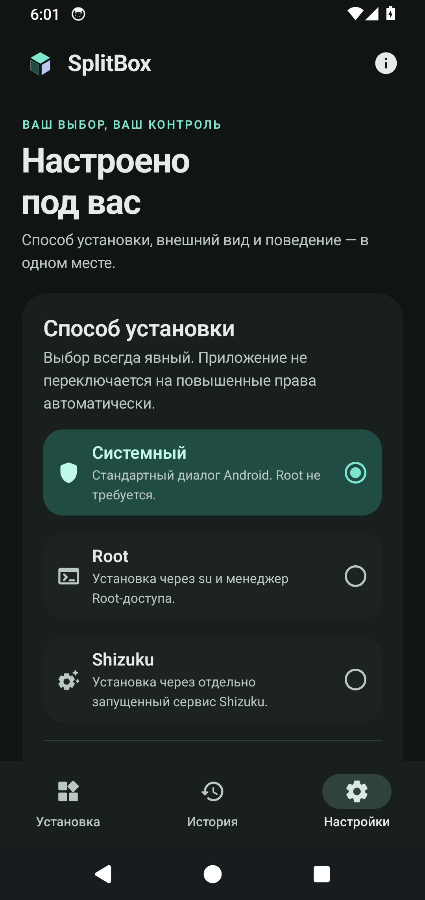

<div align="center">

# SplitBox

### Все части приложения — одна установка.

Установщик **APK · APKS · XAPK · APKM** для Android 14+.<br>
Выбирайте нужные части приложения и устанавливайте их через **System, Root или Shizuku**.

[](https://github.com/AnoY606-git/SplitBox/releases/latest)
[](#установка)
[](LICENSE)
[](https://github.com/AnoY606-git/SplitBox/actions/workflows/ci.yml)

**[Скачать APK](https://github.com/AnoY606-git/SplitBox/releases/latest)** · [Что нового](CHANGELOG.md) · [Сообщить об ошибке](https://github.com/AnoY606-git/SplitBox/issues/new/choose) · [Документация](docs/README.md)

**Без рекламы, аккаунтов и аналитики. Обработка файлов — на устройстве.**

</div>

---

SplitBox помогает установить приложение, которое скачалось архивом или набором APK. Откройте файл, проверьте выбранные части и подтвердите установку — распаковывать архив вручную не требуется.

## Как это выглядит

<p align="center">
  
  
  
</p>

<p align="center"><sub>Выбор файла · Подготовка пакета · Настройки</sub></p>

## Возможности

- **Привычное открытие файлов.** Через системный диалог, «Открыть с помощью» или «Поделиться» из проводника.
- **Контроль над частями приложения.** Автоматический подбор совместимых APK, ручной выбор, группы и фильтр выбранных. Поддерживаются наборы bundletool с `toc.pb`.
- **Проверки перед установкой.** Подписи, SHA-256, версия Android, архитектура устройства и совместимость частей пакета.
- **Три способа установки.** Системное подтверждение Android, Root или Shizuku — способ выбираете вы.
- **Понятный ход операции.** Прогресс импорта, история результатов, сохранение выбора и повтор при ошибке его сохранения.
- **Работа с OBB.** Экспорт дополнительных файлов и опциональный перенос через Root/Shizuku.
- **Оформление под себя.** Русский интерфейс, светлая, тёмная и системная темы, динамические цвета Material 3.
- **Локальная работа.** Приложение не запрашивает разрешение INTERNET. Временные файлы можно удалить в настройках.

## Установка

1. Откройте [последний релиз](https://github.com/AnoY606-git/SplitBox/releases/latest) и скачайте APK из раздела **Assets** (для версии 1.0 — **`SplitBox-1.0.apk`**).
2. Установите APK на устройство с **Android 14 или новее**.
3. Запустите SplitBox, выберите файл и проверьте состав пакета перед установкой.

### Какой способ выбрать

| Способ | Что понадобится | Как проходит установка |
| --- | --- | --- |
| **System** | Разрешение Android на установку приложений из SplitBox | Через стандартное системное подтверждение; Root не нужен |
| **Shizuku** | [Запущенный Shizuku](https://shizuku.rikka.app/download/) и доступ для SplitBox | Через сервис Shizuku |
| **Root** | Рабочий `su` и разрешение в root manager | С правами суперпользователя |

<details>
<summary><b>Если раньше была установлена предварительная dev-сборка</b></summary>

Публичные релизы подписываются постоянным ключом издателя. У предварительной `-dev.apk` другой сертификат, поэтому Android не примет обычное обновление поверх неё. Сохраните нужные данные и удалите предварительную сборку вручную перед установкой публичной версии.

</details>

## Совместимость

SplitBox поддерживает APK и открытые ZIP-контейнеры APKS, XAPK и APKM с APK внутри. **AAB напрямую, зашифрованные архивы, ZIP64, многотомные архивы и asset packs не поддерживаются.** Подписи входных APK сохраняются; ограничения Android и производителя устройства продолжают действовать.

System не переносит OBB в каталог другого приложения: для этого предусмотрены экспорт или явная опция Root/Shizuku.

Версия 1.0 проверена на AOSP Android 14, включая System и Shizuku. Реальные Magisk/KernelSU, физические ARM-устройства и Android 15/16 пока требуют проверки. Подробные сценарии и границы испытаний — в [отчёте о проверках](docs/VERIFICATION.md).

## Помочь проекту

Нашли ошибку или хотите предложить улучшение? [Создайте issue](https://github.com/AnoY606-git/SplitBox/issues/new/choose). Для ошибки укажите модель устройства, версию Android, способ установки и шаги воспроизведения. Не прикладывайте личные данные и чужие закрытые APK.

Изменения кода приветствуются — начните с [руководства для участников](CONTRIBUTING.md). Об уязвимостях сообщайте по [инструкции безопасности](SECURITY.md).

## Разработчику

Проект написан на **Kotlin**, интерфейс — **Jetpack Compose / Material 3**. Разбор пакетов вынесен в отдельное JVM-ядро. Текущая версия — **1.0**, `versionCode 3`.

| Документ | Что внутри |
| --- | --- |
| [Путеводитель](docs/README.md) | Структура проекта и точки входа в код |
| [Сборка](docs/BUILDING.md) | Инструменты, Android Studio и локальный bootstrap |
| [Архитектура](docs/ARCHITECTURE.md) | Установка, сохранение выбора и восстановление операций |
| [Тестирование](docs/TESTING.md) | Автоматические проверки и сценарии на устройстве |
| [Выпуск](docs/RELEASING.md) | Постоянная подпись, версия и упаковка |
| [Измерения](benchmark/README.md) | Macrobenchmark и генерация Baseline Profile |

<details>
<summary><b>Быстрая сборка из исходников</b></summary>

Нужны JDK 17 и Android SDK: platform 36, build-tools 36.0.0, platform-tools. Укажите `JAVA_HOME` и `ANDROID_HOME` либо SDK path в локальном `local.properties`.

```bash
./gradlew :core:test :app:testDebugUnitTest :app:lintDebug :app:assembleDebug :app:assembleRelease
python3 -m unittest discover -s scripts/tests -v
python3 scripts/check_repository.py
```

Для Windows используйте `gradlew.bat`. Debug APK находится в `app/build/outputs/apk/debug/app-debug.apk`. Release без настроенного ключа остаётся неподписанным: `app/build/outputs/apk/release/app-release-unsigned.apk`. Инструкции по подписи — в [порядке выпуска](docs/RELEASING.md).

</details>

## Лицензия и автор

Разработчик — **[AnoY606-git](https://github.com/AnoY606-git)**. Собственный код SplitBox распространяется под **GPL-3.0-only**.

При распространении сохраняйте применимые уведомления об авторстве и лицензии и предоставляйте соответствующие исходники по GPL.

Copyright © 2026 AnoY606-git and SplitBox contributors.

[Лицензия](LICENSE) · [Уведомления](NOTICE) · [Авторы](AUTHORS.md) · [Сохранение авторства](ATTRIBUTION.md) · [Сторонние компоненты](THIRD_PARTY_NOTICES.md)
