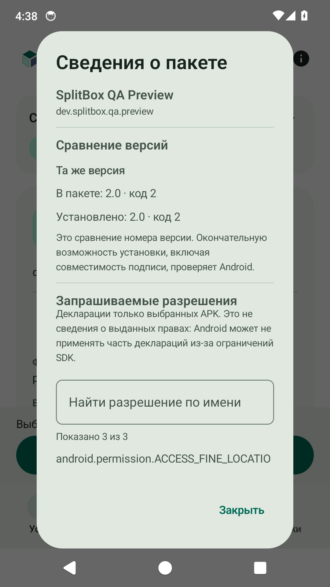

[**English**](README.md) · [Русский](README.ru.md)

<div align="center">

# SplitBox

### Every part of an app. One installation.

An **APK · APKS · XAPK · APKM** installer for Android 14+.<br>
Choose the app components you need and install them through **System, Root, or Shizuku**.

[](https://github.com/AnoY606-git/SplitBox/releases/latest)
[](#installation)
[](LICENSE)
[](https://github.com/AnoY606-git/SplitBox/actions/workflows/ci.yml)

**[Download APK](https://github.com/AnoY606-git/SplitBox/releases/latest)** · [What's new](CHANGELOG.md) · [Report a bug](https://github.com/AnoY606-git/SplitBox/issues/new/choose) · [Documentation](docs/en/README.md)

**No ads, accounts, or analytics. Files are processed on your device.**

</div>

---

SplitBox installs apps downloaded as an archive or a set of APKs. Open a file, review the selected components, and confirm installation. There is no need to unpack the archive yourself.

## Screenshots

<p align="center">
  
  
  
</p>

<p align="center"><sub>Choose files · Prepare a package · Inspect before installing</sub></p>

## Features

- **One archive or several APKs.** Import through the system picker, “Open with,” or “Share” in a file manager. Select separate components of the same app together without creating a ZIP.
- **Control over app components.** Automatic selection of compatible APKs, manual selection, groups, search, and a selected-only filter. Bundletool sets with `toc.pb` are supported.
- **Checks before installation.** Signatures, SHA-256, Android version, device architecture, and compatibility between package components.
- **Three installation methods.** Android's system confirmation, Root, or Shizuku: you choose the method. Root/Shizuku access is checked automatically when you select that mode.
- **Inspect before installing.** Compare with the installed version and view permissions declared by the selected APKs.
- **Clear operation status.** Import progress, saved selections, and retry when saving fails. History includes search, filters by outcome and installation method, and a report you can copy.
- **OBB support.** Export additional files or explicitly enable transfer through Root/Shizuku.
- **Appearance and language.** English and Russian interfaces, per-app language selection, light, dark, and system themes, and Material 3 dynamic colors.
- **Local processing.** The app does not request the INTERNET permission. Temporary files can be deleted in Settings.

## Installation

1. Open the [latest release](https://github.com/AnoY606-git/SplitBox/releases/latest) and download the APK from **Assets** (**`SplitBox-1.2.apk`** for version 1.2).
2. Install the APK on a device running **Android 14 or later**.
3. Open SplitBox, choose a file, and review the package components before installing.

### When the APKs are separate files

Tap **“Choose multiple APKs”** and select the base APK together with the required components of the same app. You can select up to 128 files; their package name, numeric version, and signatures must match. SplitBox selects compatible components automatically, and search helps you find a language or module. Install different apps one at a time.

**Package details** shows the incoming and installed version numbers and permission declarations. Android may hide information about installed packages; SplitBox then reports that comparison is unavailable. Declared permissions do not mean those permissions have been granted to the app.

### Choosing an installation method

| Method | Requirements | Installation flow |
| --- | --- | --- |
| **System** | Android permission to install apps from SplitBox | Standard system confirmation; Root is not required |
| **Shizuku** | [Running Shizuku](https://shizuku.rikka.app/download/) and access granted to SplitBox | Through the Shizuku service |
| **Root** | Working `su` and permission in your root manager | With superuser privileges |

Selecting Root checks `su` and may trigger your root manager's permission prompt. For Shizuku, SplitBox automatically checks the running service and permission. A denial does not start a repeating prompt: retry explicitly with the button in Settings. If access is blocked in Shizuku, allow it in Shizuku itself. SplitBox does not switch installation methods automatically.

Settings offers **“Follow system / Russian / English.”** This changes the app interface; language APK components are still selected using the device's system languages.

<details>
<summary><b>If you previously installed a development preview</b></summary>

Public releases use a permanent publisher signing key. An earlier `-dev.apk` uses a different certificate, so Android will reject a normal update over it. Save any data you need and manually uninstall the preview before installing the public release.

</details>

## Compatibility

SplitBox supports APKs and unencrypted APKS, XAPK, and APKM ZIP containers containing APKs. Single-disk ZIP64 is supported, including large APKS files. **Direct AAB installation, encrypted and multipart archives, and asset packs are not supported.** Input APK signatures are preserved; Android and device manufacturer restrictions still apply.

System cannot transfer OBB files into another app's directory. Use export or the explicit Root/Shizuku option for that.

Version 1.1.1 was tested on AOSP Android 14 for an update from 1.1, a 400 MiB APK with 6,008 ZIP entries, full import and installation of an APKS larger than 9 GiB through System and Shizuku, extraction cancellation, and recovery after insufficient storage or process death. Real Magisk/KernelSU, physical ARM devices, and Android 15/16 still require testing. These large-payload device runs were not repeated for 1.2. See the [verification report](docs/en/VERIFICATION.md) for the scenarios completed in each version and their limits.

## Contributing

Found a bug or have an idea? [Create an issue](https://github.com/AnoY606-git/SplitBox/issues/new/choose). For bugs, include the device model, Android version, installation method, and reproduction steps. Do not attach personal data or someone else's private APKs.

Code contributions are welcome; start with the [contributor guide](docs/en/CONTRIBUTING.md). Report vulnerabilities according to the [security policy](docs/en/SECURITY.md).

## For developers

SplitBox uses **Kotlin** and **Jetpack Compose / Material 3**. Package parsing lives in a separate JVM core. The current release is **1.2**, `versionCode 7`, tag [v1.2](https://github.com/AnoY606-git/SplitBox/releases/tag/v1.2). Previous versions remain in the release history.

| Document | Contents |
| --- | --- |
| [Developer guide](docs/en/README.md) | Project structure and code entry points |
| [Building](docs/en/BUILDING.md) | Tools, Android Studio, and local bootstrap |
| [Architecture](docs/en/ARCHITECTURE.md) | Installation, selection persistence, and operation recovery |
| [Testing](docs/en/TESTING.md) | Automated checks and device scenarios |
| [Releasing](docs/en/RELEASING.md) | Permanent signing key, versions, and packaging |
| [Benchmarks](docs/en/BENCHMARKING.md) | Macrobenchmark and Baseline Profile generation |

<details>
<summary><b>Quick source build</b></summary>

Use JDK 17 and Android SDK platform 36, build-tools 36.0.0, and platform-tools. Set `JAVA_HOME` and `ANDROID_HOME`, or set the SDK path in a local `local.properties`.

```bash
./gradlew :core:test :app:testDebugUnitTest :app:lintDebug :app:lintRelease :app:assembleDebug :app:assembleRelease
python3 -m unittest discover -s scripts/tests -v
python3 scripts/check_repository.py
```

On Windows, use `gradlew.bat`. The debug APK is `app/build/outputs/apk/debug/app-debug.apk`. A release build without signing credentials remains unsigned: `app/build/outputs/apk/release/app-release-unsigned.apk`. See [Releasing](docs/en/RELEASING.md) for signing instructions.

</details>

## License and author

Developed by **[AnoY606-git](https://github.com/AnoY606-git)**. SplitBox's own code is licensed under **GPL-3.0-only**.

When redistributing, retain the applicable copyright and license notices and provide the corresponding source code as required by the GPL.

Copyright © 2026 AnoY606-git and SplitBox contributors.

[License](LICENSE) · [Notices](NOTICE) · [Authors](docs/en/AUTHORS.md) · [Attribution](docs/en/ATTRIBUTION.md) · [Third-party components](THIRD_PARTY_NOTICES.md)
