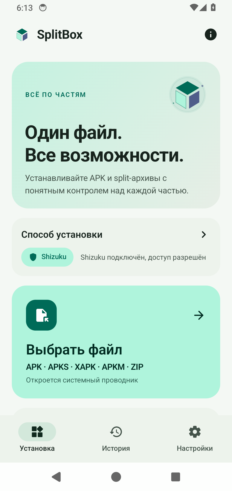
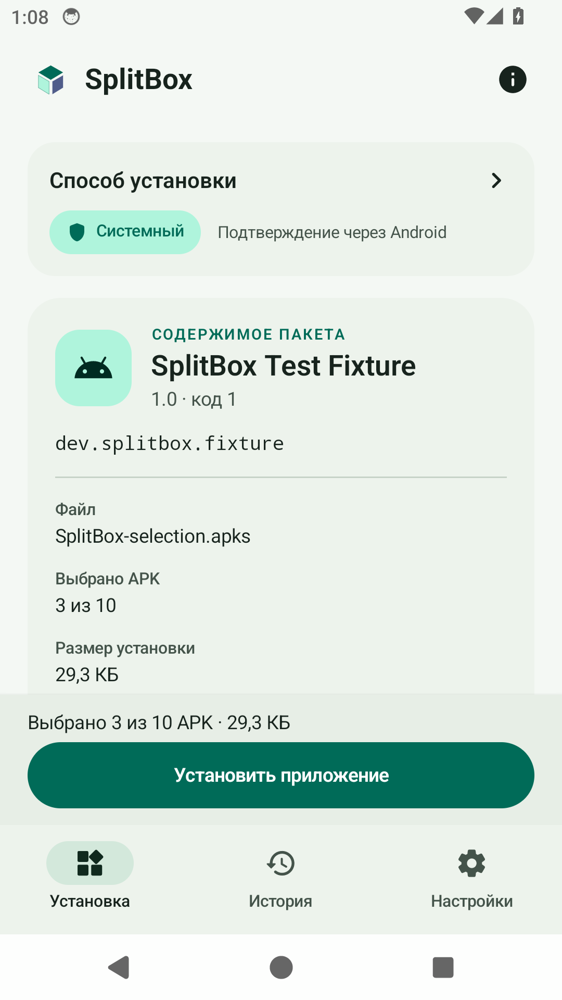

# SplitBox

Локальный установщик **APK, APKS, XAPK и APKM для Android 14+**. Версия **1.0** (versionCode **3**), Kotlin, Jetpack Compose, Material 3. Установка через Android PackageInstaller, Root или Shizuku.

**Без рекламы, аккаунтов, аналитики и разрешения INTERNET.** Автор — [AnoY606-git](https://github.com/AnoY606-git).

## Установка

[Скачать SplitBox 1.0](https://github.com/AnoY606-git/SplitBox/releases/tag/v1.0): файл `SplitBox-1.0.apk` для Android 14+. В релизе также доступны полный архив исходников, сведения о подписи и `SHA256SUMS`.

Публичный APK подписан постоянным ключом издателя. Если ранее установлена предварительная `-dev.apk`, Android не примет обычное обновление из-за другой подписи: сохраните нужные данные и удалите предварительную сборку вручную перед установкой публичной. Следующие публичные обновления используют постоянную подпись.

## Возможности

- Открытие файлов через системный диалог, «Открыть с помощью» и «Поделиться».
- Проверка package/version/SDK/ABI, подписи, SHA-256 и совместимости split APK.
- Автоматический и ручной выбор совместимых частей; поддержка bundletool `toc.pb`.
- Группы частей и фильтр выбранных, закреплённая сводка с установкой, сохранение состояния вкладок.
- Потоковое копирование с SHA-256 и счётчиком байтов; восстановление подтверждённого выбора после перезапуска.
- Явный выбор System, Root или Shizuku; история результатов и управление кэшем.
- Экспорт OBB и опциональный перенос через Root/Shizuku.
- Русский интерфейс, светлая, тёмная и системная темы; dynamic colors.

 

## Сборка

Нужны JDK 17 и Android SDK: platform 36, build-tools 36.0.0, platform-tools. Задайте `JAVA_HOME` и `ANDROID_HOME` либо SDK path в локальном `local.properties`.

```bash
./gradlew :core:test :app:testDebugUnitTest :app:lintDebug :app:assembleDebug :app:assembleRelease
python3 -m unittest discover -s scripts/tests -v
python3 scripts/check_repository.py
```

Windows: `gradlew.bat`. Для Linux есть локальный bootstrap с проверкой скачиваемых JDK/command-line tools по SHA-256 — [инструкция сборки](docs/BUILDING.md).

Debug APK: `app/build/outputs/apk/debug/app-debug.apk`. Release по умолчанию **unsigned**: `app/build/outputs/apk/release/app-release-unsigned.apk`. Подпись и упаковка описаны в [порядке выпуска](docs/RELEASING.md). `dist/` создаётся локально и не хранится в Git.

## Использование

Выберите файл, проверьте сведения и выбранные части, затем запустите установку. System требует разрешения на установку приложений и подтверждения Android. Для Root нужен рабочий `su` и разрешение root manager. Для Shizuku установите и запустите [Shizuku](https://shizuku.rikka.app/download/), затем разрешите доступ SplitBox.

Обычный System backend не переносит OBB в чужой каталог: используйте экспорт или явную опцию Root/Shizuku. Поддерживаются открытые ZIP-контейнеры с APK. AAB напрямую, encrypted containers, ZIP64/multi-volume и asset packs не поддерживаются. Подписи входных APK не меняются; ограничения Android и OEM сохраняются.

## Разработчику

Начните с [путеводителя по проекту](docs/README.md): структура кода, точки входа и маршрут изменения функции. Затем — [архитектура](docs/ARCHITECTURE.md), [тестирование](docs/TESTING.md) и [участие в разработке](CONTRIBUTING.md).

[Проверки версии 1.0 и ограничения](docs/VERIFICATION.md) описывают фактически выполненные проверки. [Контракты восстановления](docs/ARCHITECTURE.md) объясняют сохранение выбора, System journal и журнал Root/Shizuku. Неопределённый результат UNKNOWN не считается успехом или ошибкой и не вызывает автоматическую повторную установку. Методика и границы измерений — в [benchmark/README](benchmark/README.md). Номер версии сам по себе не означает, что проверены все Root/OEM/Android-сценарии.

## Лицензия

Copyright © 2026 AnoY606-git and SplitBox contributors. Собственный код — **GPL-3.0-only**. При распространении сохраняйте применимые уведомления об авторстве и лицензии и предоставляйте соответствующие исходники по GPL.

[LICENSE](LICENSE) · [NOTICE](NOTICE) · [AUTHORS](AUTHORS.md) · [условия сохранения авторства](ATTRIBUTION.md) · [сторонние компоненты](THIRD_PARTY_NOTICES.md).
