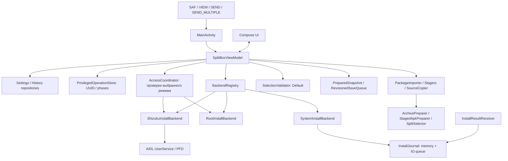

[English](en/ARCHITECTURE.md) · **Русский**

# Архитектура и контракты

## Слои и движение данных

`core` — Kotlin/JVM без Android imports: manifest/toc, безопасная распаковка ZIP и выбор совместимых splits. `app` связывает Android URI, Compose, локальные данные и установку. `fixture` содержит собственное тестовое приложение. `benchmark` измеряет отдельные тестовые варианты и не входит в runtime SplitBox.

`InstallBackend` — Strategy: ровно один способ на реализацию. `BackendRegistry` выбирает его по `BackendMode`; ошибка System не включает Root/Shizuku. `InstallRequest` передаёт пакет, выбранные APK, настройки и callbacks создания session/границ commit. Результат — `Finished` либо `SystemPending`.

ViewModel собирает зависимости, управляет текущей операцией и публикует StateFlow. Compose читает состояние и отправляет действия. `UiEvent` передаёт запрос открытия Android UI; сохраняемые notice показывают ошибки с закрытием и доступным действием повтора. Используются композиция и явная передача зависимостей без отдельного DI framework. Repositories скрывают настройки и историю на диске.

## Настройки после 1.2: неопубликованные изменения

В текущих исходниках прежние настройки объединены в группы «Установка», «Приложение» и «Файлы и данные»; внизу остаются сведения о SplitBox, GPL и лицензиях компонентов. System/Root/Shizuku представлены вертикальным списком со статусом Root/Shizuku и явным повтором проверки. Язык, тема и лимит размера показывают текущее значение и открывают диалог с одиночным выбором. Лимит сохраняет прежние варианты Авто/1/2/4/8/16/32/64 ГиБ. Ограничения при активной операции сохраняются, включая уже открытый диалог лимита. Новых настроек, зависимостей или выпуска это изменение не добавляет; версия исходников остаётся 1.2 / code 7. Исторические испытания опубликованного APK 1.2 не считаются проверкой этого интерфейса.

## Язык интерфейса и сообщения

На Android 14+ используется штатный `LocaleManager.applicationLocales`. Пустой список означает «Как в системе», `ru` и `en` — явный выбор. `locales_config.xml` объявляет языки для системного экрана настроек. Android владеет сохранением выбора; вторая независимая копия языка в SharedPreferences не создаётся. При смене языка Activity может быть пересоздана, но ViewModel и сохраняемые install/checkpoint-состояния продолжают существовать.

Ресурсы `values/strings.xml` содержат английский fallback, `values-ru/strings.xml` — русский перевод. Имена ресурсов отражают назначение сообщения; форматные аргументы позиционные. Внешние имена файлов, метки приложений и вывод Android не переводятся. Числа и даты в UI форматируются по текущему языку интерфейса. `DeviceProfile` получает языки из `LocaleManager.systemLocales`: язык приложения не становится языком целевого APK.

Для сообщений операций, ошибок JVM-ядра и сохраняемых результатов используется `MessageEnvelope`: явный ключ + типизированные аргументы + диагностический fallback на русском. Это совместимая граница для прежних полей `String`, а не распознавание или перевод русских подстрок. Только явно помеченный вложенный аргумент разрешается как ещё одно сообщение. `core` не зависит от Android, приложение разрешает ключи через закрытый список `MessageResources` и Android resources. Число аргументов, размеры и глубина ограничены; старые plain-text сообщения истории сохраняют исходный язык. При добавлении сообщения обновляйте оба каталога и список ключей, а затем запускайте тесты ресурсов и кодека. Не используйте контейнер в именах файлов, shell-командах, идентификаторах и машинных состояниях. Обрезка и скрытие URI должны выполняться структурно, без повреждения контейнера.

Причина решения: сообщения должны менять язык после восстановления состояния без повторной установки. Переписывание всех journal/checkpoint-форматов одновременно отвергнуто как избыточное для совместимого обновления; цена переходного формата — необходимость явно отделять отображаемые сообщения от внешних данных. Проверки покрывают round-trip, аргументы, некорректный ввод, каталоги и смену языка на Android. Основа API — [Android per-app languages](https://developer.android.com/guide/topics/resources/app-languages).

## Автоматическая проверка доступа

`AccessCoordinator` отвечает только за проверки доступа к выбранному `BackendMode`. Он получает адаптеры Root/Shizuku, признак активной установки, монотонное время и callback состояния. Он не выбирает другой способ и не устанавливает APK. ViewModel доставляет события и ответы на главном потоке.

При первоначально выбранном Root и явном выборе режима выполняется ограниченная по времени проверка `su -c id`. Повторные события не создают параллельные проверки. Подтверждённый Root перепроверяется при возврате с защитой от немедленного повторения; после отказа автоматический цикл прекращается, доступен явный повтор. Смена режима инвалидирует результат старой проверки.

Для Shizuku отслеживаются живой Binder, разрешение, незавершённый запрос и окончательный запрет. Автоматический запрос выполняется только в выбранном режиме при работающей службе. Ответ принимается по коду конкретного запроса; события смерти службы инвалидируют прежний запрос, даже если замещающий Binder уже появился. Отказ не вызывает повторяющихся диалогов, окончательная блокировка объясняется пользователю. Повтор и переключение вкладок не дублируют ожидающий запрос. Во время установки новые проверки откладываются. Перед самой установкой backend повторно проверяет свои предусловия: статус UI не является разрешением на привилегированное действие.

Причина решения: отдельная ручная кнопка делала настройку непонятной, а безусловная проверка на каждом `onResume` создавала бы циклы запросов и гонки. Выбран событийный координатор с ограниченной ответственностью вместо таймера и скрытого fallback. Контракт разрешений сверяется с [официальным Shizuku API](https://github.com/RikkaApps/Shizuku-API#request-permission). Тесты воспроизводят отказ, повтор, смену режима, смерть Binder, поздние callbacks и запоздалый Root-результат.

## Копирование, SHA-256 и кэш

`SourceCopier` читает поток ограниченным буфером, проверяет отмену и лимит фактически прочитанных байтов, публикует прогресс и при необходимости считает SHA-256 в том же проходе. `PackageStager.copy` возвращает число байтов и optional digest; Android-адаптер синхронизирует выходной файл. Размер, сообщённый provider через `sourceSize`, нужен для прогресса и не заменяет реальный byte limit. ViewModel использует digest копирования без отдельного чтения источника ради SHA.

Каждая операция владеет уникальным закрытым `workDir`. Для raw APK core повторно использует только собственный `workDir/source.bin`: обычный файл без symlink, с проверенной canonical принадлежностью. Этот source остаётся доступен для checkpoint и permission recovery. Внешний raw source копируется в выходной каталог; core не удаляет входной файл. Архивы проходят обычную распаковку с проверками paths, CRC, дубликатов, размеров, metadata и принадлежности OBB. Повторное использование файла не отменяет manifest, signature и selection checks.

`CacheSizeIndex.bytes()` возвращает последнее значение из памяти. Полный `rescan`, обновление одного каталога и удаление выполняются на IO, под общей синхронизацией: старый scan не должен перезаписать более новое изменение индекса. Обновляется каталог текущей операции, а не всё дерево после каждого действия. Начальное сканирование запускается независимо от восстановления journal: медленный cache не задерживает доставку результата установки. Значение индекса отражает известное состояние; внешние изменения обнаруживаются при следующем сканировании.

## Большие пакеты и ZIP64

Индекс ZIP и данные пакета имеют разные бюджеты. `ZipStructure` до создания `ZipFile` потоково проверяет EOCD, single-disk ZIP64, реальные записи центрального каталога, локальные заголовки, размеры и смещения. Все размеры файлов — `Long`; сложения/границы проверяются до обращения к данным. Индекс ограничен 32 МиБ и 100 000 ZIP-записей; отдельно допускается до 4096 APK в установочном наборе. Число ресурсов внутри одного APK не считается числом split APK. Многотомные и зашифрованные архивы отклоняются.

`PackageSizePolicy` отделяет пользовательский лимит от доступного места. Ноль означает автоматический режим; ручные значения — 1/2/4/8/16/32/64 ГиБ. По умолчанию нет искусственного потолка 2 или 4 ГиБ: поток ограничен фактическим свободным местом с резервом 64 МиБ. Это не обещает установку при любом объёме диска. Одновременно могут существовать исходный архив, распакованные APK/OBB и копия выбранных APK в сессии Android; до записи сессии проверяется место для этой дополнительной копии. Отказ по месту до запуска backend возвращает READY с прежним выбором и сохранённым указателем; после освобождения диска повторный импорт не требуется. Размер от URI-провайдера остаётся подсказкой, а не основанием доверять входному файлу.

Старые настройки не различали явно выбранные 2 ГиБ и автоматически сохранённый стандартный лимит. Однократная миграция переводит старое значение 2 в автоматический режим с пояснением пользователю; 1/4 сохраняются. После появления маркера политики новый явный выбор 2 сохраняется без изменений.

`TransferProgress` ограничивает промежуточные публикации для UI/Binder интервалом 100 мс. Проверка отмены, размер и хеш считаются на каждом блоке. Импорт явно публикует окончательный счётчик, в том числе при неизвестном или неверном размере источника. Root/Shizuku используют конечный таймаут, зависящий от количества байтов: две минуты плюс время передачи при 256 КиБ/с; Binder получает дополнительные 30 секунд. Это допускает медленные большие операции, сохраняя явную отмену и отдельную семантику неизвестного результата commit.

Причина решения: лимит 4096 ресурсов блокировал нормальные большие APK, а запрет ZIP64, пределы 2/4 ГиБ и фиксированные таймауты блокировали большие контейнеры. Простое снятие всех проверок отвергнуто: сохранены ограниченный индекс, проверка путей/дубликатов/CRC, защита от переполнений и байтовый бюджет. Контракты ZIP64 сверены с [PKWARE APPNOTE, разделы 4.3.12–16 и 4.5.3](https://pkware.cachefly.net/webdocs/casestudies/APPNOTE.TXT); Android принимает общий размер сессии как [long sizeBytes](https://developer.android.com/reference/android/content/pm/PackageInstaller.SessionParams#setSize(long)). Проверки и фактические размеры тестовых наборов находятся в [TESTING](TESTING.md) и [VERIFICATION](VERIFICATION.md).

## Импорт отдельных APK

`ImportSelection` нормализует точные URI, сохраняет порядок и ограничивает множественный запрос 128 уникальными источниками. Один URI проходит обычный путь APK/архива. Для набора `PackageImporter` вызывает `MultiApkStager`: каждый поток копируется один раз с оставшимся общим байтовым бюджетом. Имена provider используются только для отображения; физические файлы имеют фиксированные имена внутри уникального рабочего каталога.

`StagedApkPreparer` проверяет принадлежность файлов, отсутствие символических ссылок и повторов, затем использует общий `ApkInspector`, identity validation и `SplitSelector`. Вложенные архивы в таком наборе не распаковываются. Подписи проверяются обычным путём. Промежуточного ZIP нет; SHA-256 исходного файла для набора не показывается, поскольку единственного файла нет.

READY checkpoint хранит все staged paths. Если `source.bin` отсутствует, permission journal и восстановление используют сохранённый базовый APK. Набор относится к одному приложению: очередь установок разных пакетов здесь не создаётся.

## Выбор частей и READY checkpoint

После подготовки и проверки подписей записываются `PreparedSnapshot` и указатель READY в journal. Ручные переключения отправляют неизменяемый снимок в `RevisionedSaveQueue`: один последовательный IO writer объединяет ожидающие записи, каждая имеет generation/revision. Подтверждение writer продвигает `savedRevision` только своего поколения; завершение старой записи не подтверждает новый выбор.

UI показывает сохранение и ошибку. При ошибке закреплённая кнопка установки предлагает повторить сохранение; она не запускает backend. Повтор сохранения повторяет последнюю ревизию, а не установку. `flush()` ждёт подтверждения ревизии, актуальной в момент вызова, либо сообщает об ошибке/смене поколения. Перед новой операцией, сбросом или очисткой `invalidateAndAwait()` инвалидирует старые pending snapshots и ждёт уже начавшийся writer до удаления его файлов. При сбое сохраняется возможность восстановить последнюю подтверждённую запись; текущий несохранённый выбор не объявляется сохранённым. Перед install и передачей управления настройкам разрешений нужны durable barriers checkpoint/journal.

`SelectionValidator` выполняет CPU-проверку на `Dispatchers.Default`, отменяет прошлую задачу и проверяет ревизию перед публикацией. UI принимает результат для актуального выбора и блокирует установку во время проверки или при ошибке. Composition не вызывает тяжёлый `validateSelection`. Перед передачей backend набор проверяется повторно: предварительная UI-проверка не заменяет финальную проверку.

Список группирует base/feature/ABI/density/language/other, сохраняет required/locked и позволяет фильтровать выбранные строки. Сводка и действие установки вынесены из прокрутки. Вкладки используют `SaveableStateHolder`. Heading semantics обозначают группы; live region применяется к этапу/результату, а не каждому обновлению байтов. Крупный шрифт и TalkBack требуют отдельной проверки на устройстве.

## System journal и подтверждение Android

`InstallJournal.get(context)` возвращает один journal на процесс для ViewModel и receiver. Начальное чтение и JSON-разбор выполняются на IO; до recovery вызывается `awaitReady()`. Публичные reads используют снимок в памяти. Mutations создают новый snapshot с ledger, READY pointer и permission checkpoint и ставят его в последовательную IO-очередь. Сохранение использует подтверждённый `SharedPreferences.commit()`; ошибка наблюдаема через persistence state и notice.

Зависимые действия требуют `flush()`: состояние WRITING сохраняется до записи APK в session; состояние перед commit — до `session.commit`; permission checkpoint — до открытия настроек; сохранённое подтверждение Android — до отправки UI события. `InstallResultReceiver` использует `goAsync()`, ждёт готовности journal и записи обработанного результата, затем завершает pending result. При ошибке или таймауте сохранения receiver не заявляет об успешной записи.

Current и retained sessions коррелируются по исходной session, включая поздние callbacks после новой операции. Перед `startActivity` UI проверяет актуальность confirmation token; ACK отправляется после фактической попытки запуска. После IO восстановление READY и подтверждения повторно сверяет актуальность, чтобы старый снимок не заменил новый импорт. Отсутствующий Android status не означает success. UNKNOWN сохраняет неопределённость, а не разрешение повторить commit.

## Root/Shizuku: владение и доказательство результата

Root использует `su -c` и PM sessions, Shizuku — явный доступ к AIDL UserService с `ParcelFileDescriptor`. Полученный session ID фиксируется внутри IO create-блока до cancellable возврата и передаётся `onSessionCreated`. Очистка может abandon только принадлежащую операции session; доказанный commit не abandon. Ошибка/timeout/binder loss после начала commit без доказанного ответа даёт `UncertainInstallException` и UNKNOWN.

Перед запуском backend сохраняется `PrivilegedOperationRecord`: UUID операции, backend/user, package/version, время, названия, session ID, фаза и параметры cleanup/history. `FilePrivilegedOperationStore` хранит ограниченный versioned payload с digest, синхронизирует временный файл и атомарно заменяет запись. Повреждение вызывает ошибку, а не результат установки; `clear` проверяет UUID.

| Фаза | Смысл и восстановление |
| --- | --- |
| `CREATING` | Операция записана до create; доказанного итога нет → UNKNOWN |
| `WRITING` | Собственный session ID сохранён; доказанного итога нет → UNKNOWN |
| `COMMITTING` | Записана граница перед командой commit; ответ мог потеряться → UNKNOWN |
| `COMMITTED` | Успех APK доказан ответом PM; дополнительные действия могут быть не подтверждены |
| `FINISHED` | Сохранён доказанный итог с `success=true/false` и отдельным OBB warning |
| `UNKNOWN` | Итог не подтверждён, `success=null` |

Cold restore использует запись и уже сохранённый доказанный результат истории; он не вызывает `su`, bind/install или повторный commit. Запись `FINISHED` сохраняется до завершения истории/очистки. History использует UUID как ID и устраняет повторные записи той же операции; нейтральный `success=null` не превращается в `false`. Доказанный успех APK остаётся успехом при ошибке последующей записи или OBB, с отдельным предупреждением.

Для UNKNOWN после Root/Shizuku действие «Проверить статус» объясняет, как проверить установленное приложение и его версию вручную. Оно не запрашивает привилегии и не подтверждает итог автоматически. Пояснение открывается только по нажатию: обычный `onHostResumed()` не создаёт модальное окно при каждом возврате в приложение.

При явном новом импорте предыдущая privileged запись архивируется: если `saveHistory` включён, UNKNOWN сохраняется в истории с тем же UUID и nullable success, затем очищается только запись этой операции. Ошибка сохранения останавливает замену записи. Новый импорт — действие пользователя; восстановление не начинает установку за него.

## Совместимость и возврат из вспомогательных операций

Автовыбор плоских наборов сначала находит общую ABI конфигураций всех модулей и нативных библиотек основных APK, затем следует порядку ABI устройства. Ручной выбор и targeting из `toc.pb` сохраняют свои правила; итоговая проверка совместимости обязательна. Ресурсный `versionName` остаётся неразрешённым отображаемым значением; имя пакета и числовая версия проверяются строго.

`recoverSystemSession` сверяет журнал с `SessionInfo.isSealed`: существующая незапечатанная сессия после прерывания отменяется с результатом «подготовка прервана»; запечатанная сессия при восстановлении не отменяется. Отсутствие сессии остаётся UNKNOWN до доказанного ответа. После каждого приостанавливающего действия проверяется актуальность записи; повторного commit нет.

При выходе из ожидания разрешения `InstallJournalSnapshot.returnPermissionToReady` одной ревизией возвращает указатель READY и удаляет permission checkpoint. Чужая текущая сессия или более новый пакет не изменяются. При ошибке записи на диске остаётся предыдущий восстанавливаемый снимок, а ошибка доступна для повтора сохранения.

Экспорт OBB через `runObbExport` сохраняет исходную фазу, включая UNKNOWN и его журнал. В `finally` для того же пакета и выбора сверяются актуальные результаты очереди и валидатора; поздний итог Android не заменяется старым снимком. Отмена COPYING прерывает локальный Job до обращения к журналу установки. Успех, ошибка и отмена экспорта проходят один путь восстановления.

## Поиск, история и сведения о пакете

Поиск частей и переключатель «только выбранные» фильтруют представление `SplitPresentation`, не меняя `selectedPaths`, валидацию или общий счётчик установки. Запрос сохраняется при смене вкладок и сбрасывается при новом `workDir`. `HistoryPresentation` объединяет поиск, статус и способ установки через AND; `success=null` остаётся отдельным неизвестным исходом. Отчёт строится из выбранной записи и версии SplitBox. Диалог сохраняет неизменяемый текст предпросмотра, который копируется только явным действием пользователя.

`BinaryManifestReader` читает Android-декларации разрешений и их ограничения SDK. `ApkMetadata.requestedPermissions=null` означает неизвестные данные, а пустой список — успешный разбор без деклараций. `PermissionSnapshot` сохраняет это различие: отсутствующее или повреждённое поле старого checkpoint не превращается в «разрешений нет».

`PackageInspectionLoader` получает установленную версию через интерфейс `InstalledPackageReader` и собирает разрешения выбранных APK на IO. Сравниваются `Long` versionCode; `NameNotFoundException` означает «не установлено или недоступно для проверки» из-за Android package visibility. Результат не обещает совместимость подписи или возможность downgrade. Открытие диалога запускает новую проверку; закрытие, смена пакета, выбора или фазы отменяет эффект. После синхронного запроса Package Manager проверяется отмена, чтобы старый ответ не появился в новом диалоге.

## Перенос OBB и отмена

При успешной установке APK с неперенесённым OBB сохраняется весь подготовленный пакет, checkpoint и подтверждённый указатель READY. После перезапуска экспорт снова доступен; автоматическая очистка откладывается, об этом сообщает результат. После экспорта кэш можно очистить явно. Отмена переноса OBB становится доступной только после подтверждённого commit APK и не отменяет уже успешную установку.

Внешний `trap EXIT` не гарантирует очистку после SIGKILL. `ObbCopyPlan` сохраняет точный временный путь текущей операции; основной shell открывает его до запуска `cat`, который пишет только в уже открытый дескриптор. `ProcessRunner` ограниченно ждёт завершения процесса. Root выполняет отдельную очистку в `NonCancellable` с таймаутом 15 секунд; Shizuku удаляет временный файл внутри `finally`, до освобождения monitor, которого ждёт завершение UserService. Очистка не использует маски и не удаляет конечный OBB. Ошибка удаления сообщается отдельно от доказанного успеха APK. Это проверяется настоящим shell и медленным потоком: SIGKILL, interrupt, ранняя отмена, сохранение прежнего OBB и чужого временного файла.

## Общие инварианты

- Входные URI и архивы недоверенные; имена архива не подставляются в shell, пути остаются внутри staging.
- Одна активная установка; отмена после commit не означает откат установленного приложения.
- UNKNOWN не является успехом или доказанной ошибкой. Автоматический повтор commit и скрытый переход между backend запрещены.
- Журнал и история не переносятся через Android backup: session IDs принадлежат конкретному Package Manager.
- Проверки модели не доказывают поведение конкретного OEM, root manager, физического ARM или 16 KiB runtime.

Карта файлов — [путеводитель](README.md); проверки контрактов — [TESTING](TESTING.md); методика измерений — [benchmark/README](../benchmark/README.md).

## Решения из других открытых проектов

При исправлении больших пакетов изучены проекты того же автора: [FrameScope](https://github.com/AnoY606-git/framescope/blob/30c2f75747e228e97e7a5443f3f912ee08711592/src/FrameScope.App/Services/DemoRuntime.cs), [OpenAuth](https://github.com/AnoY606-git/OpenAuth/blob/97371532d00115bc51e5e826c98737b62cb21651/app/src/androidTest/kotlin/dev/openauth/app/ui/RestorePreviewLayoutTest.kt) и [Open-TimeManager](https://github.com/AnoY606-git/Open-TimeManager/tree/4a5aa9456f81f4ee121a15362b1fa5d922a817d1). Из FrameScope использован принцип разделения частоты чтения данных и обновления UI; из OpenAuth — проверка фактического интерфейса на узком экране с крупным шрифтом. Код реализован в контрактах SplitBox, файлы и ресурсы других приложений не копировались.

Принудительная отмена блокирующего SAF I/O и удаление нового неполного документа при ошибке экспорта требуют отдельного владения потоком/URI и проверки гонок. Они остаются ограничениями: текущая отмена проверяется между чтениями; при ошибке экспорта приложение сообщает о возможном неполном ZIP. Перенос ограниченного ByteArray-импорта чужого приложения на многогигабайтные APK не подходит.

## Основания возможностей 1.1

При выборе функций изучены первичные репозитории [SAI](https://github.com/Aefyr/SAI), [InstallerX Revived](https://github.com/wxxsfxyzm/InstallerX-Revived) и [App Manager](https://github.com/MuntashirAkon/AppManager). Для SplitBox выбраны связанные с установкой сценарии: прямой набор APK, сведения до установки, поиск и отчёт. Реализация собственная; код других приложений не переносился. Ограничения видимости установленных пакетов учитывают [Android package visibility](https://developer.android.com/training/package-visibility/declaring).
