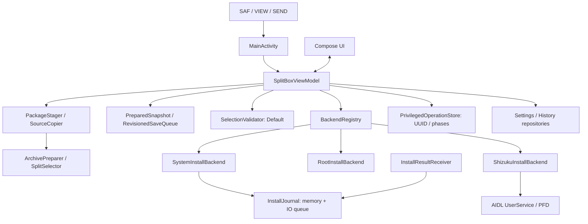

# Архитектура и контракты

## Слои и движение данных

`core` — Kotlin/JVM без Android imports: manifest/toc, безопасная распаковка ZIP и выбор совместимых splits. `app` связывает Android URI, Compose, локальные данные и установку. `fixture` содержит собственное тестовое приложение. `benchmark` измеряет отдельные тестовые варианты и не входит в runtime SplitBox.

`InstallBackend` — Strategy: ровно один способ на реализацию. `BackendRegistry` выбирает его по `BackendMode`; ошибка System не включает Root/Shizuku. `InstallRequest` передаёт пакет, выбранные APK, настройки и callbacks создания session/границ commit. Результат — `Finished` либо `SystemPending`.

ViewModel собирает зависимости, управляет текущей операцией и публикует StateFlow. Compose читает состояние и отправляет действия. `UiEvent` передаёт запрос открытия Android UI; сохраняемые notice показывают ошибки с закрытием и доступным действием повтора. Используются композиция и явная передача зависимостей без отдельного DI framework. Repositories скрывают настройки и историю на диске.

## Копирование, SHA-256 и кэш

`SourceCopier` читает поток ограниченным буфером, проверяет отмену и лимит фактически прочитанных байтов, публикует прогресс и при необходимости считает SHA-256 в том же проходе. `PackageStager.copy` возвращает число байтов и optional digest; Android-адаптер синхронизирует выходной файл. Размер, сообщённый provider через `sourceSize`, нужен для прогресса и не заменяет реальный byte limit. ViewModel использует digest копирования без отдельного чтения источника ради SHA.

Каждая операция владеет уникальным закрытым `workDir`. Для raw APK core повторно использует только собственный `workDir/source.bin`: обычный файл без symlink, с проверенной canonical принадлежностью. Этот source остаётся доступен для checkpoint и permission recovery. Внешний raw source копируется в выходной каталог; core не удаляет входной файл. Архивы проходят обычную распаковку с проверками paths, CRC, дубликатов, размеров, metadata и принадлежности OBB. Повторное использование файла не отменяет manifest, signature и selection checks.

`CacheSizeIndex.bytes()` возвращает последнее значение из памяти. Полный `rescan`, обновление одного каталога и удаление выполняются на IO, под общей синхронизацией: старый scan не должен перезаписать более новое изменение индекса. Обновляется каталог текущей операции, а не всё дерево после каждого действия. Начальное сканирование запускается независимо от восстановления journal: медленный cache не задерживает доставку результата установки. Значение индекса отражает известное состояние; внешние изменения обнаруживаются при следующем сканировании.

## Выбор частей и READY checkpoint

После подготовки и проверки подписей записываются `PreparedSnapshot` и указатель READY в journal. Ручные переключения отправляют неизменяемый снимок в `RevisionedSaveQueue`: один последовательный IO writer объединяет ожидающие записи, каждая имеет generation/revision. Подтверждение writer продвигает `savedRevision` только своего поколения; завершение старой записи не подтверждает новый выбор.

UI показывает сохранение и ошибку. При ошибке закреплённая кнопка установки предлагает повторить сохранение; она не запускает backend. Повтор сохранения повторяет последнюю ревизию, а не установку. `flush()` ждёт подтверждения ревизии, актуальной в момент вызова, либо сообщает об ошибке/смене поколения. Перед новой операцией, сбросом или очисткой `invalidateAndAwait()` инвалидирует старые pending snapshots и ждёт уже начавшийся writer до удаления его файлов. При сбое сохраняется возможность восстановить последнюю подтверждённую запись; текущий несохранённый выбор не объявляется сохранённым. Перед install и передачей управления настройкам разрешений нужны durable barriers checkpoint/journal.

`SelectionValidator` выполняет CPU-проверку на `Dispatchers.Default`, отменяет прошлую задачу и проверяет ревизию перед публикацией. UI принимает результат для актуального выбора и блокирует установку во время проверки или при ошибке. Composition не вызывает тяжёлый `validateSelection`. Перед передачей backend набор проверяется повторно: предварительная UI-проверка не заменяет финальную проверку.

Список группирует base/feature/ABI/density/language/other, сохраняет required/locked и позволяет фильтровать выбранные строки. Сводка и действие установки вынесены из прокрутки. Вкладки используют `SaveableStateHolder`. Heading semantics обозначают группы; live region применяется к этапу/результату, а не каждому обновлению байтов. Крупный шрифт и TalkBack требуют отдельной проверки на устройстве.

## System journal и подтверждение Android

`InstallJournal.get(context)` возвращает один journal на процесс для ViewModel и receiver. Начальное чтение и JSON-разбор выполняются на IO; до recovery вызывается `awaitReady()`. Публичные reads используют снимок в памяти. Mutations создают новый snapshot с ledger, READY pointer и permission checkpoint и ставят его в последовательную IO-очередь. Сохранение использует подтверждённый `SharedPreferences.commit()`; ошибка наблюдаема через persistence state и notice.

Зависимые действия требуют `flush()`: состояние WRITING сохраняется до записи APK в session; состояние перед commit — до `session.commit`; permission checkpoint — до открытия настроек; сохранённое подтверждение Android — до отправки UI события. `InstallResultReceiver` использует `goAsync()`, ждёт готовности journal и записи обработанного результата, затем завершает pending result. При ошибке или таймауте сохранения receiver не заявляет об успешной записи.

Current и retained sessions коррелируются по исходной session, включая поздние callbacks после новой операции. Перед `startActivity` UI проверяет актуальность confirmation token; ACK отправляется после фактической попытки запуска. После IO восстановление READY и подтверждения повторно сверяет актуальность, чтобы старый снимок не заменил новый импорт. Отсутствующий Android status не означает success. UNKNOWN сохраняет неопределённость, а не разрешение повторить commit.

## Root/Shizuku: владение и доказательство результата

Root использует `su -c` и PM sessions, Shizuku — явный доступ к AIDL UserService с `ParcelFileDescriptor`. Полученный session ID фиксируется внутри IO create-блока до cancellable возврата и передаётся `onSessionCreated`. Очистка может abandon только принадлежащую операции session; доказанный commit не abandon. Ошибка/timeout/binder loss после начала commit без доказанного ответа даёт `UncertainInstallException` и UNKNOWN.

Перед запуском backend сохраняется `PrivilegedOperationRecord`: UUID операции, backend/user, package/version, время, названия, session ID, фаза и параметры cleanup/history. `FilePrivilegedOperationStore` хранит ограниченный versioned payload с digest, синхронизирует временный файл и атомарно заменяет запись. Повреждение вызывает ошибку, а не результат установки; `clear` проверяет UUID.

| Фаза | Смысл и восстановление |
| --- | --- |
| `CREATING` | Операция записана до create; доказанного итога нет → UNKNOWN |
| `WRITING` | Собственный session ID сохранён; доказанного итога нет → UNKNOWN |
| `COMMITTING` | Записана граница перед командой commit; ответ мог потеряться → UNKNOWN |
| `COMMITTED` | Успех APK доказан ответом PM; дополнительные действия могут быть не подтверждены |
| `FINISHED` | Сохранён доказанный итог с `success=true/false` и отдельным OBB warning |
| `UNKNOWN` | Итог не подтверждён, `success=null` |

Cold restore использует запись и уже сохранённый доказанный результат истории; он не вызывает `su`, bind/install или повторный commit. Запись `FINISHED` сохраняется до завершения истории/очистки. History использует UUID как ID и устраняет повторные записи той же операции; нейтральный `success=null` не превращается в `false`. Доказанный успех APK остаётся успехом при ошибке последующей записи или OBB, с отдельным предупреждением.

Для UNKNOWN после Root/Shizuku действие «Проверить статус» объясняет, как проверить установленное приложение и его версию вручную. Оно не запрашивает привилегии и не подтверждает итог автоматически. Пояснение открывается только по нажатию: обычный `onHostResumed()` не создаёт модальное окно при каждом возврате в приложение.

При явном новом импорте предыдущая privileged запись архивируется: если `saveHistory` включён, UNKNOWN сохраняется в истории с тем же UUID и nullable success, затем очищается только запись этой операции. Ошибка сохранения останавливает замену записи. Новый импорт — действие пользователя; восстановление не начинает установку за него.

## Совместимость и возврат из вспомогательных операций

Автовыбор плоских наборов сначала находит общую ABI конфигураций всех модулей и нативных библиотек основных APK, затем следует порядку ABI устройства. Ручной выбор и targeting из `toc.pb` сохраняют свои правила; итоговая проверка совместимости обязательна. Ресурсный `versionName` остаётся неразрешённым отображаемым значением; имя пакета и числовая версия проверяются строго.

`recoverSystemSession` сверяет журнал с `SessionInfo.isSealed`: существующая незапечатанная сессия после прерывания отменяется с результатом «подготовка прервана»; запечатанная сессия при восстановлении не отменяется. Отсутствие сессии остаётся UNKNOWN до доказанного ответа. После каждого приостанавливающего действия проверяется актуальность записи; повторного commit нет.

При выходе из ожидания разрешения `InstallJournalSnapshot.returnPermissionToReady` одной ревизией возвращает указатель READY и удаляет permission checkpoint. Чужая текущая сессия или более новый пакет не изменяются. При ошибке записи на диске остаётся предыдущий восстанавливаемый снимок, а ошибка доступна для повтора сохранения.

Экспорт OBB через `runObbExport` сохраняет исходную фазу, включая UNKNOWN и его журнал. В `finally` для того же пакета и выбора сверяются актуальные результаты очереди и валидатора; поздний итог Android не заменяется старым снимком. Отмена COPYING прерывает локальный Job до обращения к журналу установки. Успех, ошибка и отмена экспорта проходят один путь восстановления.

## Общие инварианты

- Входные URI и архивы недоверенные; имена архива не подставляются в shell, пути остаются внутри staging.
- Одна активная установка; отмена после commit не означает откат установленного приложения.
- UNKNOWN не является успехом или доказанной ошибкой. Автоматический повтор commit и скрытый переход между backend запрещены.
- Журнал и история не переносятся через Android backup: session IDs принадлежат конкретному Package Manager.
- Проверки модели не доказывают поведение конкретного OEM, root manager, физического ARM или 16 KiB runtime.

Карта файлов — [путеводитель](README.md); проверки контрактов — [TESTING](TESTING.md); методика измерений — [benchmark/README](../benchmark/README.md).
