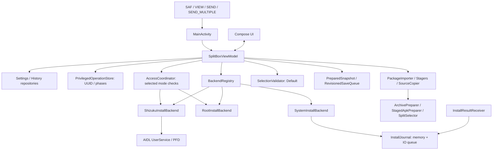

**English** · [Русский](../ARCHITECTURE.md) · [Developer guide](README.md)

# Architecture and contracts

## Layers and data flow

`core` is Kotlin/JVM without Android imports: manifest/toc parsing, safe ZIP extraction, and compatible split selection. `app` connects Android URIs, Compose, local persistence, and installation. `fixture` contains the project's own test app. `benchmark` measures separate test variants and is outside SplitBox's runtime.

`InstallBackend` follows Strategy: exactly one installation method per implementation. `BackendRegistry` selects it by `BackendMode`; a System error does not enable Root/Shizuku. `InstallRequest` carries the package, selected APKs, settings, and callbacks for session creation/commit boundaries. The result is `Finished` or `SystemPending`.

ViewModel assembles dependencies, controls the current operation, and publishes StateFlow. Compose reads state and sends actions. `UiEvent` requests Android UI; persisted notices show dismissible errors and a retry action where available. Composition and explicit dependency passing are used without a separate DI framework. Repositories encapsulate settings and history on disk.

## Settings after 1.2: unreleased source changes

The current source groups existing settings into Installation, App, and Files and data, followed by About SplitBox, GPL, and component licenses. System/Root/Shizuku use a vertical list with inline Root/Shizuku status and explicit retry. Language, theme, and package-size rows show their current value and open a single-choice dialog. Size choices remain Auto/1/2/4/8/16/32/64 GiB. Active-operation restrictions remain, including an already open size-limit dialog. This adds no settings, dependencies, or published release; source version remains 1.2 / code 7. Historical testing of the published 1.2 APK does not certify this interface.

## Interface language and messages

Android 14+ uses the native `LocaleManager.applicationLocales`. An empty list means “System default”; `ru` and `en` are explicit selections. `locales_config.xml` declares languages for system settings. Android owns persistence; there is no second independent language copy in SharedPreferences. A language change may recreate Activity, while ViewModel and persisted install/checkpoint state survive.

`values/strings.xml` supplies the English fallback; `values-ru/strings.xml` supplies Russian. Resource names describe a message's purpose; format arguments are positional. External filenames, app labels, and Android output are not translated. UI numbers and dates use the current interface language. `DeviceProfile` reads `LocaleManager.systemLocales`: the app's interface language does not become the target APK's language.

Operation messages, JVM core errors, and persisted results use `MessageEnvelope`: an explicit key, typed arguments, and a Russian diagnostic fallback. This is a compatible boundary for existing `String` fields; it does not detect or translate Russian substrings. Only an explicitly marked nested argument is resolved as another message. `core` has no Android dependency; the app resolves keys through a closed `MessageResources` list and Android resources. Argument counts, size, and depth are bounded. Old plain-text history messages retain their original language. Add new messages to both catalogs and the key list, then run resource and codec tests. Do not use the envelope in filenames, shell commands, identifiers, or machine states. Truncation and URI redaction must operate structurally without corrupting the envelope.

Rationale: messages must change language after state recovery without reinstalling. Rewriting all journal/checkpoint formats at once was rejected as unnecessary for a compatible update. The transitional format requires explicit separation between display messages and external data. Checks cover round-trip, arguments, malformed input, catalogs, and Android language changes. API basis: [Android per-app languages](https://developer.android.com/guide/topics/resources/app-languages).

## Automatic access checks

`AccessCoordinator` only checks access for the selected `BackendMode`. It receives Root/Shizuku adapters, an active-install flag, monotonic time, and a state callback. It neither selects another method nor installs APKs. ViewModel delivers events and responses on the main thread.

Initially selected Root and explicit mode selection trigger a bounded `su -c id` check. Repeated events do not create concurrent checks. Confirmed Root is rechecked on resume with protection against immediate repetition. Denial ends automatic retries; explicit retry remains available. Changing modes invalidates results from an old check.

Shizuku tracks a live Binder, permission, a pending request, and permanent denial. Automatic permission requests occur only in the selected mode with the service running. A response must match its request code. Service-death events invalidate the old request even if a replacement Binder has arrived. Denial does not create repeated dialogs; permanent blocking is explained to the user. Retry and tab switching do not duplicate a pending request. New checks are deferred during installation. Before installing, the backend rechecks its preconditions: UI status does not authorize a privileged action.

Rationale: a separate manual button made setup unclear, while checking unconditionally on every `onResume` would create prompt loops and races. A narrowly responsible event coordinator was chosen over a timer or hidden fallback. The permission contract follows the [official Shizuku API](https://github.com/RikkaApps/Shizuku-API#request-permission). Tests reproduce denial, retry, mode changes, Binder death, late callbacks, and delayed Root results.

## Copying, SHA-256, and cache

`SourceCopier` reads with a bounded buffer, checks cancellation and the actual byte limit, publishes progress, and optionally calculates SHA-256 in the same pass. `PackageStager.copy` returns the byte count and optional digest; the Android adapter synchronizes the output file. Provider-reported `sourceSize` is a progress hint, not a substitute for the actual byte limit. ViewModel reuses the copy digest instead of rereading the source for SHA.

Each operation owns a unique private `workDir`. For a raw APK, core reuses only its own `workDir/source.bin`: a regular file without symlinks and with verified canonical ownership. The source remains available for checkpoint and permission recovery. External raw sources are copied to the output directory; core does not delete input files. Archives undergo normal extraction with path, CRC, duplicate, size, metadata, and OBB ownership checks. File reuse does not bypass manifest, signature, or selection checks.

`CacheSizeIndex.bytes()` returns the latest in-memory value. Full `rescan`, per-directory update, and deletion run on IO under shared synchronization: an old scan must not overwrite a newer index mutation. Only the current operation's directory is updated after an action, rather than rescanning the entire tree. Initial scanning is independent of journal recovery, so slow cache access does not delay installation results. The index reflects known state; external changes are found on the next scan.

## Large packages and ZIP64

ZIP index and package data have separate budgets. Before creating `ZipFile`, `ZipStructure` streams checks of EOCD, single-disk ZIP64, actual central-directory entries, local headers, sizes, and offsets. File sizes use `Long`; additions and bounds are checked before data access. The index is limited to 32 MiB and 100,000 ZIP entries, separately from the limit of 4,096 APKs per installation set. Resources within one APK do not count as split APKs. Multipart and encrypted archives are rejected.

`PackageSizePolicy` separates the user limit from available storage. Zero means automatic; manual values are 1/2/4/8/16/32/64 GiB. Default behavior imposes no artificial 2 or 4 GiB ceiling: the stream is bounded by actual available space with a 64 MiB reserve. This does not promise installation with arbitrary disk capacity. The original archive, extracted APKs/OBB, and Android session's copy of the selected APKs may coexist. Space for the extra session copy is checked before writing it. A storage failure before backend invocation returns READY with the same selection and persisted pointer; no reimport is needed after freeing space. A provider's reported size remains a hint rather than evidence that the input is trustworthy.

Old settings could not distinguish an explicitly chosen 2 GiB limit from the automatically saved default. A one-time migration changes old value 2 to automatic with a user explanation; 1/4 remain. Once the policy marker exists, a new explicit 2 GiB choice is preserved.

`TransferProgress` limits intermediate UI/Binder publication to 100 ms intervals. Cancellation checks, byte accounting, and hashing still occur on each block. Import explicitly publishes the final count, including unknown or incorrect source sizes. Root/Shizuku use a finite byte-dependent timeout: two minutes plus transfer time at 256 KiB/s, with another 30 seconds for Binder. This accommodates slow large operations while retaining explicit cancellation and uncertain-commit semantics.

Rationale: a 4,096-resource limit rejected ordinary large APKs, while rejecting ZIP64, 2/4 GiB caps, and fixed timeouts blocked large containers. Removing all checks was rejected: bounded indexes, path/duplicate/CRC checks, overflow protection, and byte budgets remain. ZIP64 contracts follow [PKWARE APPNOTE sections 4.3.12–16 and 4.5.3](https://pkware.cachefly.net/webdocs/casestudies/APPNOTE.TXT); Android accepts total session size as [long sizeBytes](https://developer.android.com/reference/android/content/pm/PackageInstaller.SessionParams#setSize(long)). Checks and actual dataset sizes are documented in [Testing](TESTING.md) and [Verification](VERIFICATION.md).

## Importing separate APKs

`ImportSelection` normalizes exact URIs, preserves order, and limits a multi-source request to 128 unique inputs. One URI follows the ordinary APK/archive path. For a set, `PackageImporter` calls `MultiApkStager`: each stream is copied once within the remaining shared byte budget. Provider names are display-only; physical files have fixed names within a unique working directory.

`StagedApkPreparer` checks file ownership, symlinks, and duplicates, then uses the shared `ApkInspector`, identity validation, and `SplitSelector`. Nested archives in the set are not extracted. Signatures follow the usual verification path. There is no intermediate ZIP; no source-file SHA-256 is shown for a set because there is no single source file.

READY checkpoints include all staged paths. Without `source.bin`, permission journal and recovery use the persisted base APK. The set belongs to one app; this path does not create an installation queue for different packages.

## Component selection and READY checkpoint

After preparation and signature checks, `PreparedSnapshot` and the journal's READY pointer are written. Manual toggles enqueue immutable snapshots in `RevisionedSaveQueue`: one sequential IO writer coalesces pending writes, each with generation/revision. Writer confirmation advances `savedRevision` only for its generation; an old write cannot confirm a new selection.

UI shows saving and failures. On failure, the pinned install action offers to retry saving; it does not invoke a backend. Save retry repeats the latest revision rather than the installation. `flush()` waits for the revision current at the time of the call, or reports failure/generation change. Before a new operation, reset, or cleanup, `invalidateAndAwait()` invalidates old pending snapshots and waits for an already running writer before its files are deleted. Failure preserves recovery of the last confirmed write; the current unsaved selection is not reported as saved. Installation and handoff to permission settings require durable checkpoint/journal barriers.

`SelectionValidator` performs CPU checks on `Dispatchers.Default`, cancels the previous task, and checks revision before publishing. UI accepts results only for the current selection and blocks installation while checks run or fail. Composition does not call expensive `validateSelection`. The set is checked again before backend handoff; the preliminary UI check does not replace final validation.

The list groups base/feature/ABI/density/language/other, retains required/locked status, and supports selected-only filtering. Summary and install action are outside the scrolling region. Tabs use `SaveableStateHolder`. Heading semantics identify groups; live region applies to stages/results rather than every byte update. Large fonts and TalkBack require separate device checks.

## System journal and Android confirmation

`InstallJournal.get(context)` provides one journal per process for ViewModel and receiver. Initial reads and JSON parsing run on IO; recovery calls `awaitReady()` first. Public reads use the in-memory snapshot. Mutations create a new snapshot containing ledger, READY pointer, and permission checkpoint, then enqueue it in a sequential IO queue. Persistence uses confirmed `SharedPreferences.commit()`; failures are visible through persistence state and a notice.

Dependent actions require `flush()`: WRITING is durable before APK writes to the session; pre-commit state before `session.commit`; permission checkpoint before opening settings; and Android confirmation before its UI event. `InstallResultReceiver` uses `goAsync()`, waits for journal readiness and durable processed-result storage, then finishes the pending result. It does not claim successful persistence after a storage failure or timeout.

Current and retained sessions are correlated to the originating session, including late callbacks after a new operation. Before `startActivity`, UI verifies that the confirmation token is current; ACK follows the actual launch attempt. After IO, READY/confirmation recovery checks currency again so an old snapshot cannot replace a new import. Missing Android status is not success. UNKNOWN preserves uncertainty rather than authorizing another commit.

## Root/Shizuku: ownership and evidence of outcome

Root uses `su -c` and PM sessions; Shizuku uses explicitly authorized AIDL UserService with `ParcelFileDescriptor`. The session ID is captured inside the IO create block before the cancellable return and passed to `onSessionCreated`. Cleanup may abandon only the operation's own session; a proven commit is not abandoned. Failure/timeout/Binder loss after commit begins, without a proven response, yields `UncertainInstallException` and UNKNOWN.

Before backend execution, `PrivilegedOperationRecord` persists operation UUID, backend/user, package/version, time, names, session ID, phase, and cleanup/history parameters. `FilePrivilegedOperationStore` stores a bounded versioned payload with a digest, synchronizes the temporary file, and atomically replaces the record. Corruption is an error, not an installation outcome; `clear` checks UUID.

| Phase | Meaning and recovery |
| --- | --- |
| `CREATING` | Recorded before create; no proven outcome → UNKNOWN |
| `WRITING` | Owned session ID persisted; no proven outcome → UNKNOWN |
| `COMMITTING` | Pre-commit boundary persisted; response may be lost → UNKNOWN |
| `COMMITTED` | PM response proves APK success; additional actions may remain unconfirmed |
| `FINISHED` | Proven outcome persisted with `success=true/false` and separate OBB warning |
| `UNKNOWN` | Outcome unconfirmed, `success=null` |

Cold restore uses the record and any already persisted proven history outcome; it does not call `su`, bind/install, or repeat commit. `FINISHED` survives until history/cleanup completes. History uses UUID as ID and deduplicates an operation; neutral `success=null` does not become `false`. Proven APK success remains success after a later persistence or OBB error, with a separate warning.

For Root/Shizuku UNKNOWN, “Check status” explains how to check the installed app and version manually. It requests no privileges and does not confirm the outcome automatically. The explanation opens only on a button press; ordinary `onHostResumed()` does not show a modal on every return.

Explicit new import archives the previous privileged record: with `saveHistory`, UNKNOWN is saved with the same UUID and nullable success, then only that operation's record is cleared. Save failure stops replacement. New import is a user action; recovery does not initiate installation on their behalf.

## Compatibility and returning from auxiliary operations

Flat-set automatic selection first finds the ABI common to every module's configurations and the main APKs' native libraries, then follows device ABI preference. Manual selection and `toc.pb` targeting keep their own rules; final compatibility checks remain mandatory. Resource-based `versionName` remains unresolved display data; package name and numeric version are validated strictly.

`recoverSystemSession` compares the journal to `SessionInfo.isSealed`: an existing unsealed session after interruption is abandoned with a preparation-interrupted result; a sealed session is not abandoned during recovery. A missing session remains UNKNOWN until a proven response. Currency is checked after each suspending action; commit is not repeated.

On leaving permission waiting, `InstallJournalSnapshot.returnPermissionToReady` restores READY and removes the permission checkpoint in one revision. It does not alter another current session or a newer package. A persistence failure leaves the previous recoverable disk snapshot and exposes a save retry.

OBB export through `runObbExport` retains the original phase, including UNKNOWN and its journal. In `finally`, for the same package and selection, current queue and validator results are reconciled; a late Android outcome is not replaced by an old snapshot. Cancelling COPYING stops the local Job before touching the install journal. Export success, failure, and cancellation share the same recovery path.

## Search, history, and package information

Split search and selected-only filtering operate on `SplitPresentation` without changing `selectedPaths`, validation, or the total install count. Search survives tab changes and resets with a new `workDir`. `HistoryPresentation` combines search, outcome, and installation method with AND; `success=null` is a separate unknown outcome. A report uses the selected record and SplitBox version. Its dialog retains immutable preview text copied only by explicit user action.

`BinaryManifestReader` reads Android permission declarations and SDK constraints. `ApkMetadata.requestedPermissions=null` means unknown data; an empty list means successful parsing with no declarations. `PermissionSnapshot` preserves this distinction: missing or damaged fields in old checkpoints do not become “no permissions.”

`PackageInspectionLoader` reads the installed version through `InstalledPackageReader` and collects selected APK permissions on IO. It compares `Long` version codes. `NameNotFoundException` means “not installed or unavailable to inspect” because of Android package visibility. The result promises neither signature compatibility nor downgrade feasibility. Opening the dialog starts a new check; closing it or changing package, selection, or phase cancels the effect. Cancellation is checked after synchronous Package Manager access so a stale response cannot enter a new dialog.

## OBB transfer and cancellation

After successful APK installation with untransferred OBB, the whole prepared package, checkpoint, and confirmed READY pointer are retained. Export is available after restart; automatic cleanup is deferred and the result explains this. Cache may be explicitly cleared after export. OBB transfer can be cancelled only after a confirmed APK commit; cancellation does not undo the successful installation.

An outer `trap EXIT` does not guarantee cleanup after SIGKILL. `ObbCopyPlan` keeps the operation's exact temporary path. The main shell opens it before starting `cat`, which writes only to the already open descriptor. `ProcessRunner` waits a bounded time for process exit. Root performs separate `NonCancellable` cleanup with a 15-second timeout; Shizuku removes the temporary file in `finally` before releasing the monitor awaited by UserService completion. Cleanup uses no wildcards and does not remove the final OBB. Deletion failure is separate from proven APK success. Real-shell/slow-stream tests cover SIGKILL, interrupt, early cancellation, preservation of existing OBB and unrelated temporary files.

## Shared invariants

- Input URIs and archives are untrusted; archive names are not interpolated into shell commands, and paths stay within staging.
- One installation is active at a time; cancellation after commit does not roll back the installed app.
- UNKNOWN is neither success nor proven failure. Automatic commit retry and hidden backend switching are prohibited.
- Android backup does not transfer journal/history: session IDs belong to a specific Package Manager.
- Model tests do not prove behavior on a specific OEM, root manager, physical ARM device, or 16 KiB runtime.

See the [developer guide](README.md) for files, [Testing](TESTING.md) for contract checks, and [Benchmarks](BENCHMARKING.md) for measurement methodology.

## Lessons from other open projects

Large-package work consulted the same author's [FrameScope](https://github.com/AnoY606-git/framescope/blob/30c2f75747e228e97e7a5443f3f912ee08711592/src/FrameScope.App/Services/DemoRuntime.cs), [OpenAuth](https://github.com/AnoY606-git/OpenAuth/blob/97371532d00115bc51e5e826c98737b62cb21651/app/src/androidTest/kotlin/dev/openauth/app/ui/RestorePreviewLayoutTest.kt), and [Open-TimeManager](https://github.com/AnoY606-git/Open-TimeManager/tree/4a5aa9456f81f4ee121a15362b1fa5d922a817d1). FrameScope informed separating data-read frequency from UI-update frequency; OpenAuth informed actual UI checks on narrow screens with large fonts. Implementation follows SplitBox's contracts; other apps' files and resources were not copied.

Force-cancelling blocking SAF I/O and deleting a new partial document after export failure require separate stream/URI ownership and race checks. These remain limitations: cancellation is currently checked between reads; export failures warn that an incomplete ZIP may remain. Another app's bounded ByteArray import is unsuitable for multi-gigabyte APKs.

## Background to version 1.1 features

Feature selection consulted the primary repositories [SAI](https://github.com/Aefyr/SAI), [InstallerX Revived](https://github.com/wxxsfxyzm/InstallerX-Revived), and [App Manager](https://github.com/MuntashirAkon/AppManager). SplitBox chose installation-related workflows: direct APK sets, pre-install inspection, search, and reports. Implementation is original; other apps' code was not copied. Installed-package visibility limitations follow [Android package visibility](https://developer.android.com/training/package-visibility).
